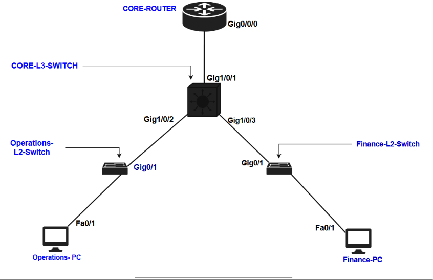
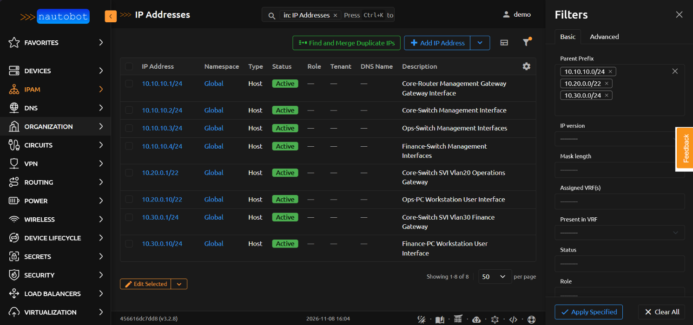
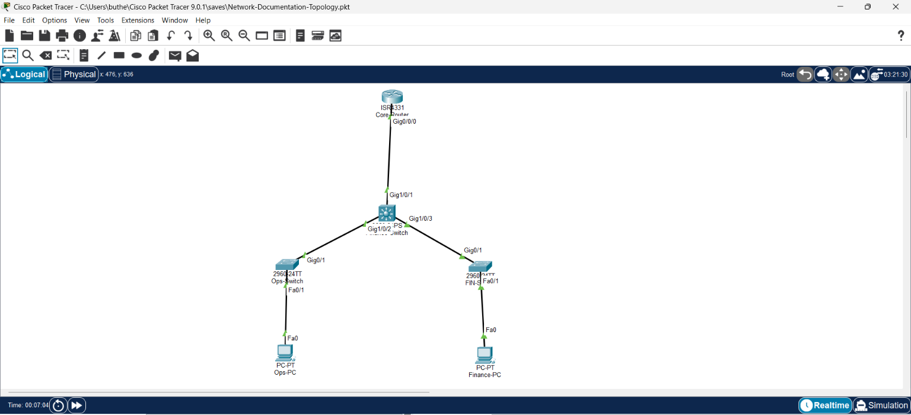
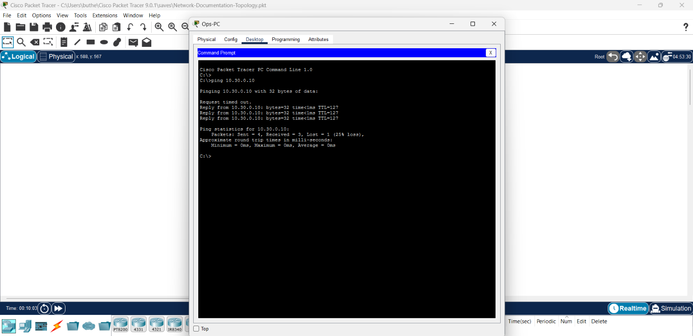

# ENTERPRISE NETWORK ARCHITECTURE RUNBOOK
**Document Reference:** RB-HQ-NET-001  
**Environment Platform:** Cisco Packet Tracer & Nautobot IPAM Simulation  
**Classification:** Internal Engineering Technical Reference  

---

## 1. ARCHITECTURAL OVERVIEW & LOGICAL BOUNDARIES

This document provides the technical implementation instructions to deploy, configure, and restore the regional corporate headquarters network fabric from an absolute zero-state. 

The underlying infrastructure design utilizes an In-Band Management architecture over a shared Layer 2 broadcast domain. It incorporates local VLAN pruning on access switches to optimize the processing of Layer 2 broadcast frames and implements Variable Length Subnet Masking (VLSM) to allocate IP address blocks efficiently based on departmental scaling requirements.

### 1.1 Physical Topology Mapping
The physical connection map below illustrates the active hardware placements, distribution trunks, and edge layer access port paths implemented across the campus architecture.



### 1.2 IP Address Management (IPAM) Registry (Nautobot Source-of-Truth)
*   **VLAN 10 (Management Subnet):** `10.10.10.0/24` — Dedicated plane for hardware switch infrastructure virtual interfaces and edge routing termination gateways.
*   **VLAN 20 (Operations Subnet):** `10.20.0.0/22` — Mask optimized to support up to 1,022 logical host addresses for high-workforce departmental growth.
*   **VLAN 30 (Finance Subnet):** `10.30.0.0/24` — Mask optimized to support up to 254 logical host addresses, enforcing strict regulatory broadcast isolation.

### 1.3 Centralized IPAM Allocation Table
*   `10.10.10.1/24`  — `Core-Router`     ... Physical Interface `Gig0/0/0` (Management Gateway)
*   `10.10.10.2/24`  — `Core-Switch`     ... Switch Virtual Interface `Vlan10` (Switch Management Platform)
*   `10.10.10.3/24`  — `Ops-Switch`      ... Switch Virtual Interface `Vlan10` (Operations Switch Management)
*   `10.10.10.4/24`  — `Finance-Switch`  ... Switch Virtual Interface `Vlan10` (Finance Switch Management)
*   `10.20.0.1/22`   — `Core-Switch`     ... Switch Virtual Interface `Vlan20` (Operations Default Gateway)
*   `10.20.0.10/22`  — `Ops-PC`          ... Host Station Network Card (Operations Workstation)
*   `10.30.0.1/24`   — `Core-Switch`     ... Switch Virtual Interface `Vlan30` (Finance Default Gateway)
*   `10.30.0.10/24`  — `Finance-PC`      ... Host Station Network Card (Finance Workstation)

### 1.4 Nautobot IPAM Database Verification
The master database registry view below confirms that the logical network subnets, prefix boundaries, and individual host device configuration parameters match our target architecture layout:



### 1.5 Engineering Note: Nautobot Database Assignment State
*Inside pure IPAM-focused documentation implementations, standalone IP Address objects are created independently to register and reserve address space blocks within the subnet prefix fabric. To change the system status of these IP objects to an "Assigned" checkmark state inside a production Nautobot instance, an engineer must first build out the physical inventory model (Device Chassis and Virtual Machine templates) and map these IPs directly to their respective Hardware/Virtual Interface Cards (NICs).*

---

## 2. REBUILD CLI DEPLOYMENT GUIDE

The physical topology layout below outlines our active Packet Tracer implementation workspace before command configurations are executed:



Execute the following configuration blocks across your network devices sequentially, one device at a time.

### 2.1 Core-Router Configuration
```text
Router> enable
Router# configure terminal
Router(config)# hostname Core-Router
Core-Router(config)# interface GigabitEthernet0/0/0
Core-Router(config-if)# ip address 10.10.10.1 255.255.255.0
Core-Router(config-if)# no shutdown
Core-Router(config-if)# exit
Core-Router(config)# exit
Core-Router# copy running-config startup-config
```

### 2.2 Core-Switch Configuration (Layer 3 Routing Engine)
```text
Switch> enable
Switch# configure terminal
Switch(config)# hostname Core-Switch
Core-Switch(config)# ip routing
Core-Switch(config)# vlan 10
Core-Switch(config-vlan)# name Management
Core-Switch(config-vlan)# vlan 20
Core-Switch(config-vlan)# name Operations
Core-Switch(config-vlan)# vlan 30
Core-Switch(config-vlan)# name Finance
Core-Switch(config-vlan)# exit
Core-Switch(config)# interface vlan 10
Core-Switch(config-if)# ip address 10.10.10.2 255.255.255.0
Core-Switch(config-if)# no shutdown
Core-Switch(config-if)# exit
Core-Switch(config)# interface vlan 20
Core-Switch(config-if)# ip address 10.20.0.1 255.255.252.0
Core-Switch(config-if)# no shutdown
Core-Switch(config-if)# exit
Core-Switch(config)# interface vlan 30
Core-Switch(config-if)# ip address 10.30.0.1 255.255.255.0
Core-Switch(config-if)# no shutdown
Core-Switch(config-if)# exit
Core-Switch(config)# interface GigabitEthernet1/0/1
Core-Switch(config-if)# switchport mode access
Core-Switch(config-if)# switchport access vlan 10
Core-Switch(config-if)# exit
Core-Switch(config)# interface range GigabitEthernet1/0/2 - 3
Core-Switch(config-if-range)# switchport mode trunk
Core-Switch(config-if-range)# exit
Core-Switch(config)# exit
Core-Switch# write memory
```

### 2.3 Operations Access Switch Configuration
```text
Switch> enable
Switch# configure terminal
Switch(config)# hostname Ops-Switch
Ops-Switch(config)# vlan 10
Ops-Switch(config-vlan)# name Management
Ops-Switch(config-vlan)# vlan 20
Ops-Switch(config-vlan)# name Operations
Ops-Switch(config-vlan)# exit
Ops-Switch(config)# interface vlan 10
Ops-Switch(config-if)# ip address 10.10.10.3 255.255.255.0
Ops-Switch(config-if)# no shutdown
Ops-Switch(config-if)# exit
Ops-Switch(config)# interface GigabitEthernet0/1
Ops-Switch(config-if)# switchport mode trunk
Ops-Switch(config-if)# exit
Ops-Switch(config)# interface FastEthernet0/1
Ops-Switch(config-if)# switchport mode access
Ops-Switch(config-if)# switchport access vlan 20
Ops-Switch(config-if)# exit
Ops-Switch(config)# exit
Ops-Switch# write memory
```

### 2.4 Finance Access Switch Configuration
```text
Switch> enable
Switch# configure terminal
Switch(config)# hostname Finance-Switch
Finance-Switch(config)# vlan 10
Finance-Switch(config-vlan)# name Management
Finance-Switch(config-vlan)# vlan 30
Finance-Switch(config-vlan)# name Finance
Finance-Switch(config-vlan)# exit
Finance-Switch(config)# interface vlan 10
Finance-Switch(config-if)# ip address 10.10.10.4 255.255.255.0
Finance-Switch(config-if)# no shutdown
Finance-Switch(config-if)# exit
Finance-Switch(config)# interface GigabitEthernet0/1
Finance-Switch(config-if)# switchport mode trunk
Finance-Switch(config-if)# exit
Finance-Switch(config)# interface FastEthernet0/1
Finance-Switch(config-if)# switchport mode access
Finance-Switch(config-if)# switchport access vlan 30
Finance-Switch(config-if)# exit
Finance-Switch(config)# exit
Finance-Switch# write memory
```

---

## 3. SYSTEM CONNECTIVITY VERIFICATION

To validate data-plane operations and confirm proper implementation of Inter-VLAN routing transitions:
1. Log into the local CLI environment of `Ops-PC` (`10.20.0.10/22`).
2. Run the diagnostic ICMP echo tool targeting the remote subnet destination host:
   ```text
   ping 10.30.0.10
   ```
3. **Success Criteria:** A 75% to 100% round-trip completion matrix with a latency profile under `<1ms` verifies an active, error-free production configuration state.

The verification terminal execution output below confirms end-to-end routing transit validation:


